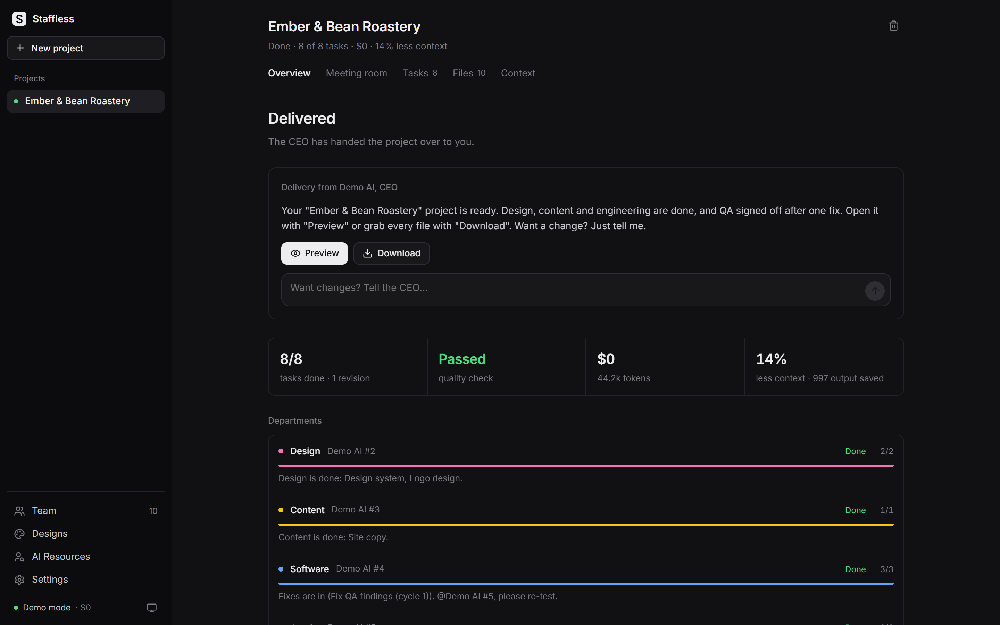
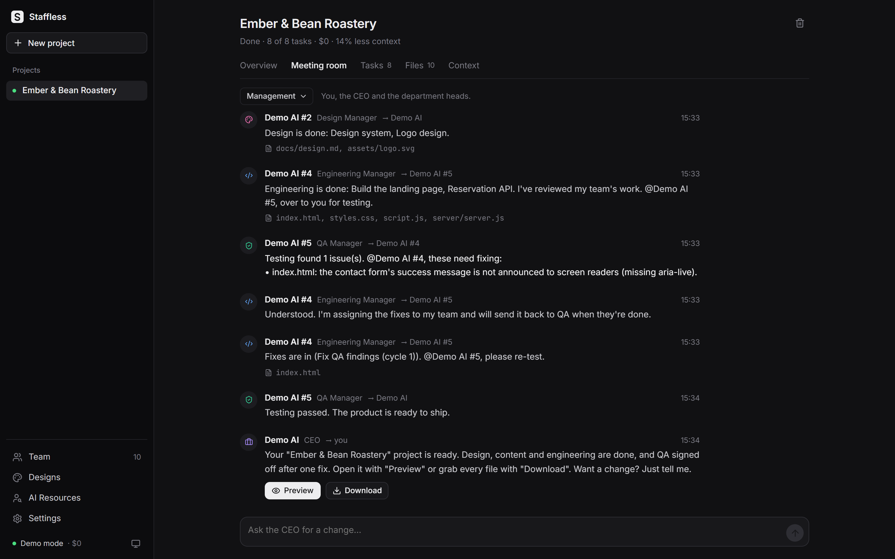
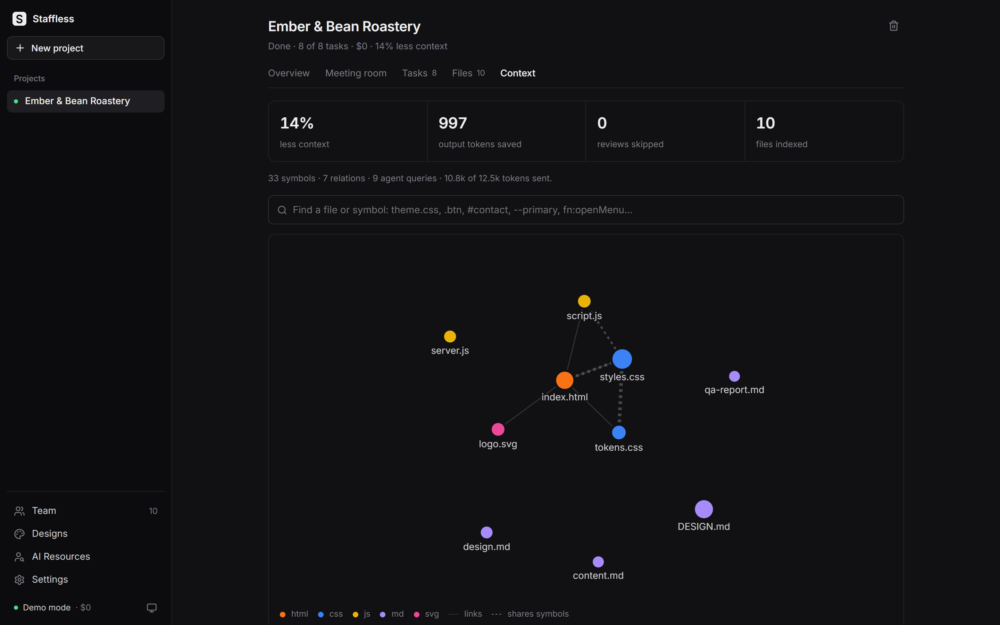
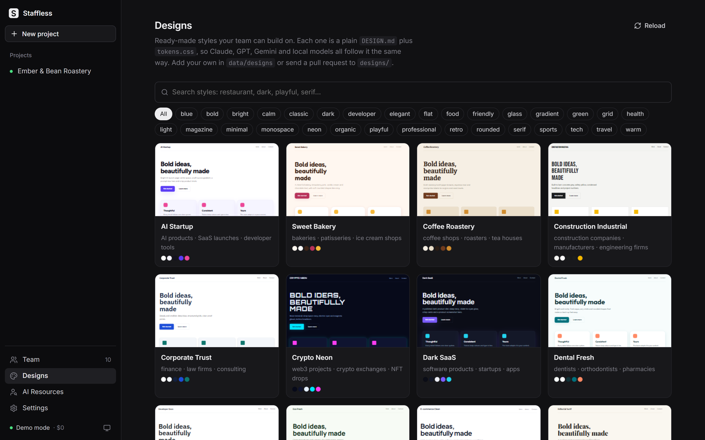
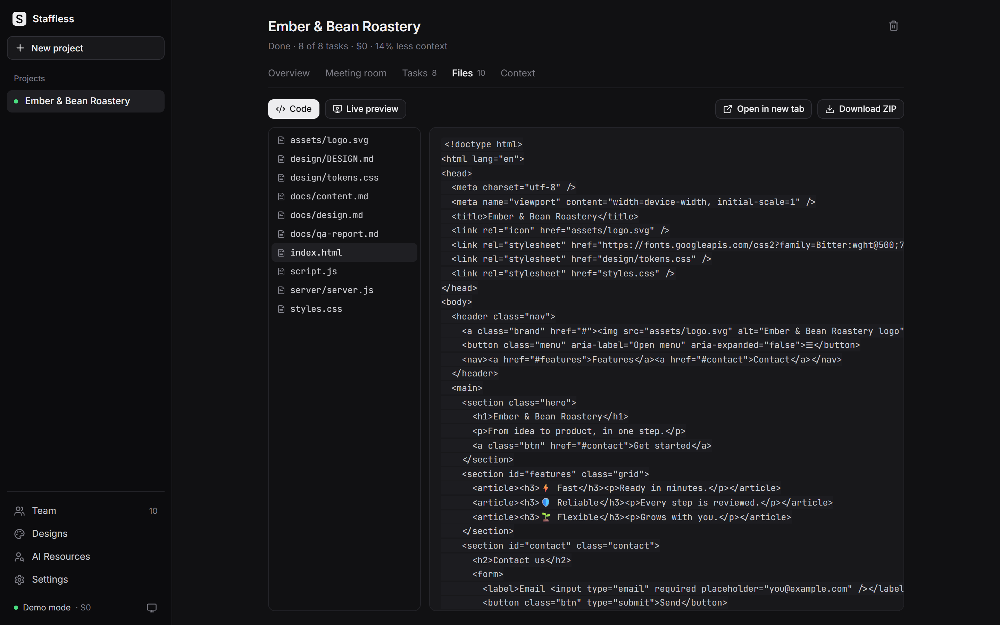
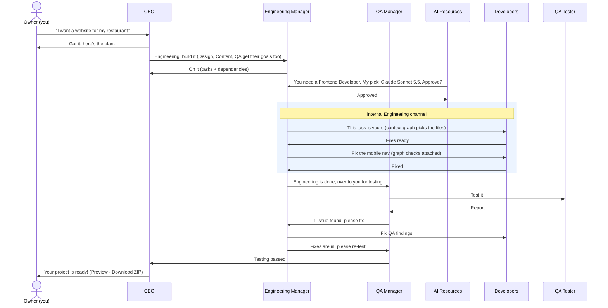

<p align="center">
  
</p>

<h1 align="center">Staffless</h1>

<p align="center">
  <b>A company with no staff. Every employee is an AI.</b><br>
  An open-source software company that gets great work out of AI while spending as few tokens as possible.
</p>

<p align="center">
  <a href="LICENSE"></a>
  
  
  
  
  <a href="CONTRIBUTING.md"></a>
</p>

<p align="center">
  <a href="#-quick-start">Quick start</a> ·
  <a href="#-highlights">Highlights</a> ·
  <a href="#-how-a-project-flows">How it works</a> ·
  <a href="#-context-graph">Context graph</a> ·
  <a href="#-providers">Providers</a> ·
  <a href="CONTRIBUTING.md">Contributing</a>
</p>

<p align="center">
  
</p>

You are the client. You say _"I want a website like this"_. The **CEO** plans it, **department managers** say _"on it"_ and split the work across their teams. When a team is missing someone, **AI Resources** (the AI counterpart of Human Resources) ranks the available models for that role and asks the manager who needs the worker. If the manager accepts, the model is hired. The team ships **real files** you can preview and download.

**No API key required.** It runs on the **Claude Code** or **Codex CLI** subscription you already pay for, launching the CLI in the background for every employee. API keys (Anthropic, OpenAI, Gemini, any OpenAI-compatible endpoint) and free local models via **Ollama** work too. With nothing configured it starts in **demo mode**, so you can try it in a minute.

---

## 🚀 Quick start

Requires **Node.js 20+**.

```bash
git clone https://github.com/suphiyasin/staffless-company.git
cd staffless-company
npm install
npm run dev
```

Open **http://127.0.0.1:4747** and describe what you want built. Then pick how your employees think:

| Option | Setup | Cost |
|---|---|---|
| ⭐ **Claude Code** (Claude Pro / Max) | `npm i -g @anthropic-ai/claude-code` → `claude auth login` | your subscription, no API key |
| **Codex CLI** (ChatGPT Plus / Pro) | `npm i -g @openai/codex` → `codex login` | your subscription, no API key |
| **API keys** | `cp .env.example .env` and fill in `ANTHROPIC_API_KEY`, `OPENAI_API_KEY`, `GEMINI_API_KEY`… | pay per token |
| **Ollama** (local) | install [Ollama](https://ollama.com) and pull a model | free |
| **Demo mode** | nothing | free, simulated AI |

> [!TIP]
> Logged-in CLIs are **detected automatically** at startup (or with **Settings → Refresh models**). Staffless runs them headless (`claude -p`, `codex exec`), so no terminal window opens and your API keys are never billed for CLI work. You can mix options: every employee can run on a different model. Details in [Providers](#-providers).

| Command | What it does |
|---|---|
| `npm run dev` | API + panel with auto-reload |
| `npm run build && npm start` | production build |
| `npm run typecheck` | TypeScript strict check |

## ✨ Highlights

|  |  |
|---|---|
| 👔 **A real chain of command** | CEO → department managers (Design, Content, Engineering, QA) → employees. Engineering reviews its developers' work, then hands it to QA. If QA fails it, engineering gets fix tasks and QA re-tests before anything is delivered. |
| 🧑‍💼 **AI Resources hires the right model** | It spots the missing role, scores every model by skill, price and speed, and proposes three candidates to the **requesting manager**, who accepts one or does the work personally. Approval can also go to you, or be fully automatic. |
| 🏷️ **Employees are named after their AI** | `Claude Sonnet 5.5`, `GPT-5 mini`, `Claude Haiku 5.5 #2`… You always see which model did what, and what it cost. |
| 🕸️ **Context graph** | A knowledge graph of each project, rebuilt in milliseconds without any LLM. Agents get only the files their task needs plus a one-line summary of everything else. **95% less context** on the test fixture. |
| ✅ **Free quality checks** | `php -l`, `ast.parse`, `node --check`, plus graph checks for broken links, unstyled classes, ghost `#id`s and undefined CSS variables, all before any paid review. |
| 👀 **Browser check** | QA opens the site in a real headless Chrome/Edge, records script errors, broken images and sideways scrolling on a phone, and takes screenshots that QA and the Design Manager actually look at. |
| 🎨 **Design library** | 40 ready-made styles (Sport Energy, Editorial Serif, Fintech Modern…) as plain `DESIGN.md` + `tokens.css`, or let the design team write one and save it to your library. |
| 📱 **Telegram** | Send a brief from your phone, get the plan, the QA verdict and the finished project as a ZIP, and approve hires with one tap. |
| 🔌 **Multi-provider** | Claude Code, Codex CLI, Anthropic, OpenAI, Gemini, Ollama and any OpenAI-compatible API. Every employee can run on a different model. |
| 💸 **Cost control** | Cost tracking per employee and per project, an optional budget cap, and token-saving tricks everywhere (see below). |

## 📸 Screenshots

<table>
  <tr>
    <td width="50%"></td>
    <td width="50%"></td>
  </tr>
  <tr>
    <td align="center"><b>Meeting room</b>: managers report, QA sends back a fix, the CEO delivers</td>
    <td align="center"><b>Context graph</b>: what each agent saw, and what it saved</td>
  </tr>
  <tr>
    <td width="50%"></td>
    <td width="50%"></td>
  </tr>
  <tr>
    <td align="center"><b>Design library</b>: 40 styles with live previews</td>
    <td align="center"><b>Files</b>: code, live preview and ZIP download</td>
  </tr>
</table>

## 🔄 How a project flows



**You are the boss.** Each project opens on an **Overview** report: where it stands, what needs your attention, every department's progress and latest report, the QA verdict and the delivery. The **Meeting room**'s management channel carries the CEO, the department heads' reports, the QA verdict and the delivery. Everything inside a team (assignments, reviews, revisions) stays in that team's internal channel, which you can peek into but which never comes to you on its own. Hiring talk stays in **AI Resources**.

After delivery you can ask for **follow-up changes** in plain language; the CEO opens a new round on the same project.

## 🕸️ Context graph

Sending the whole project to every agent on every call is slow, expensive and distracting. Staffless keeps a knowledge graph of each project instead, in the spirit of graphify, but specialised for this job and built for speed:

| | graphify | Staffless context graph |
|---|---|---|
| Runs | separate Python CLI | in-process TypeScript |
| Extraction | AST + optional LLM pass for docs | deterministic extractors, **no LLM, zero tokens** |
| Updates | rebuild / `--update` | **automatic** after every file write; unchanged files are skipped by mtime/size, then by hash |
| Output | general graph + report | task-ready context with a **token budget**, a project map and **quality checks** |

**Measured on the included test fixture** (7 files, a 6.6k-token project with large design and copy docs; a frontend fix task):

- full build: **~6 ms**, no-op sync: **<1 ms**, one changed file: **~1 ms**
- context sent: **350 tokens instead of 6,655 (95% less)**, with every relevant code file included
- all 4 planted bugs found (missing files, unstyled classes, a ghost `#id`, an undefined CSS variable), no false positives

Small demo projects fit almost entirely in one context, so savings there are small; they grow with the project. The **Context** tab shows the graph, the live savings and the automated check results for every project.

<details>
<summary><b>What it indexes</b></summary>

<br>

Every text file, plus the symbols it defines or uses, with a dedicated extractor per language:

| Language | What is extracted |
|---|---|
| HTML / templates (Twig, Blade, Jinja, Vue, Svelte…) | ids, classes, headings, `href`/`src`/`action` links, inline `<style>`/`<script>` |
| CSS / SCSS | classes, CSS variables, `url()` and `@import` |
| JavaScript / TypeScript | functions, classes, DOM queries (`querySelector`, `classList`…), imports, `fetch` targets |
| PHP | functions, classes, `include`/`require`, `header('Location: …')`, and the embedded HTML |
| Python | functions, classes, Flask/FastAPI routes, project-local imports, `render_template`, `url_for('static')` |
| SQL | tables |
| Go, Java, C#, Ruby, Rust, shell… | functions and types |
| Config (`requirements.txt`, `.env`, YAML, TOML…) | packages / keys (never secret values) |

Relations are derived on demand: _A links to B_ and _A uses a symbol B defines_. Python's stdlib and pip imports are stored as optional links, so `import os` is never reported as a missing file.

</details>

<details>
<summary><b>How it picks context for a task</b></summary>

<br>

1. **Seeds:** files the task builds on (dependency outputs), files named in the task, and the employee's previous attempt during a revision. Always sent in full.
2. **Graph neighbours** (1-2 hops) of the seeds, then **keyword hits** on paths, headings and symbols.
3. Files are packed in full until the **context budget** (default 24k tokens, configurable) runs out.
4. Every other file costs **one line** in the map (`docs/design.md [md, ~4514 tok] Design System · Colors · Typography`), so nothing is invisible and nothing is paid for twice.

Further refinements:

- **Excerpts of big neighbours.** When a task only needs part of a large file, the graph sends just that part: the CSS rules for the classes the task's files actually use (plus `:root` tokens and base rules), or only the relevant sections of a long design document. The text is copied verbatim, so find/replace edits still apply, and a file seen only as an excerpt can never be rewritten wholesale. On the test fixture a 1.8k-token stylesheet shrank to its four relevant rules.
- **Ask for more instead of guessing.** If an employee needs a file it only sees as a one-line summary, it lists it in `needFiles` and gets the task again with that file in full (once per task).
- **Impact analysis.** Reviews list the files that depend on the change and run the checks on them too; fixes and re-tests pull those dependents into context.
- **A compact map.** The one-line-per-file map is grouped by folder, so paths are not repeated.
- **Query it yourself.** The **Context** tab has a search box: type a file or a symbol (`.btn`, `#contact`, `--primary`, `fn:openMenu`) to see where it is defined and used; click a file to see what it depends on and what depends on it.

</details>

### 💸 More ways it saves tokens

- **Edits instead of rewrites.** Output tokens cost several times more than input tokens, so employees change existing files with exact find/replace edits instead of re-sending whole files. Edits are all-or-nothing per file; if a `find` doesn't match exactly once, the file is left untouched and the employee is asked to retry.
- **Free syntax checks before any review.** `php -l`, Python `ast.parse` and `node --check` run on every changed file (none of them execute the code; results are cached by file hash). Broken code goes straight back to the employee, so no manager review is spent on work that can't pass.
- **Map-only context for everything else.** Planning, re-planning and delivery read the one-line project map instead of the files.
- **Cheap calls where judgment is light.** Hiring decisions run at low effort, management reports are templated (zero tokens), and the QA ship/no-ship verdict is part of the QA review call instead of a separate one.

### 🐘 PHP, Python and other stacks

Ask for it in the brief (_"…in PHP with MySQL"_, _"…a Flask app"_). The CEO and Engineering Manager follow the requested stack and its conventions (`index.php` / `app.py` at the root, a README with run instructions, no hard-coded secrets). For PHP projects, **Files → Run with PHP** serves the project with PHP's built-in server on `127.0.0.1` (it stops after 30 minutes). This runs AI-written code on your machine, so the panel asks for confirmation first. Interpreters are auto-detected (XAMPP's PHP included) or set with `PHP_BIN` / `PYTHON_BIN`.

## 🧑‍💼 How AI Resources decides

AI Resources itself does **not** use a language model. Its ranking is deterministic, free and always explainable:

1. **Team size follows the workload.** A department with little work (by default one task) hires nobody: its manager does it personally. Busier teams get one worker per two open tasks of a role, up to "max employees per role". Five backend tasks → three backend developers; one copy task → the Content Manager writes it.
2. **The best model for the job.** Every role has skill weights (e.g. Frontend Developer: 75% coding, 25% design) and a tier; every model in [`config/models.json`](config/models.json) has 1-10 skill scores, a price and a speed. Under the default **Balanced** priority:

   | Tier | Roles | Hires | Effort |
   |---|---|---|---|
   | critical | CEO, Engineering Manager, developers | the model that scores best for the role (e.g. Claude Opus 5.5) | high |
   | standard | design, QA | the cheapest model within 1 point of the best | medium |
   | light | copy, SEO | the cheapest model that is good enough (6+) | low |

   The **effort** (how long the model thinks on each task) is decided at hiring and stored on the employee: deep thinking where quality matters, quick and cheap elsewhere. Change it per employee from the Team page.

   **Quality** hires the best model everywhere (ultra-premium models included); **Economy** steps every tier down one notch. With only Claude Code connected that means Opus for engineering, Sonnet for design and QA, Haiku for copy. **Team → Apply best fit** moves existing idle employees to the current best match.
3. **The top three candidates go to the approver.** By default that is the manager who asked for the worker: one short, low-effort call per manager covers all of that team's open requests. If a hire is declined, the manager does the task personally.

<details>
<summary><b>How local models (Ollama) are rated</b></summary>

<br>

Local models are rated by size, and the model generation adds or removes one point. Small local models only get the simplest work:

| Size | Rating | Used for |
|---|---|---|
| under 10B (e.g. Llama 3.1 8B) | 2-4 | nothing, unless no other model is available |
| 10-100B (e.g. Qwen3 14B, Llama 3.3 70B) | 5-7 | copy and SEO only, where a free local model beats a paid one |
| 100B+ recent (gpt-oss 120B, Qwen3 235B: 8), 500B+ (DeepSeek V3, Kimi K2: 9) | 8-9 | any role, competing with the cloud models |

Custom persona models (a Modelfile with its own SYSTEM prompt and a name that isn't a known model family) and embedding models are skipped; list one in `config/models.json` to hire it anyway. Thinking models (Qwen3, DeepSeek R1…) think only when the task's effort is above low. After installing a model, press **Settings → Refresh models**.

</details>

## 🎨 Design library

Open **Designs** to browse the library with live previews, or press **Style** under the brief box when you start a project. The chosen design is copied into the project as `design/DESIGN.md` and `design/tokens.css`; the design team adapts it instead of inventing a new system, and engineering links `tokens.css` and uses its variables.

Choose _"let the designers decide"_ and the design team writes the project's own design system **in the same format** as its first task. The files are validated automatically, the Overview previews them, and **Save to library** makes the style available for your next projects.

A design is a folder with two plain files, a "design skill" that Claude, GPT, Gemini and local models all read the same way (about 600 tokens, and only design and engineering tasks receive it):

```
designs/sport-energy/
  DESIGN.md    # frontmatter + principles, layout, typography, colour, components, do / don't
  tokens.css   # CSS variables with fixed names
```

<details>
<summary><b>The format</b></summary>

<br>

```markdown
---
id: sport-energy
name: Sport Energy
description: Match-day energy: black and fiery red, condensed uppercase headlines.
tags: [bold, dark, sports]
best_for: [sports clubs, gyms, esports, events]
fonts: [Oswald:500,700, Inter:400,600]   # Google Fonts families
---
# Sport Energy
## Principles
## Layout
## Typography
## Color
## Components
## Do / Don't
```

`tokens.css` must define every variable of the shared contract, so one sample page (and every generated site) works with any design:

`--color-bg` `--color-surface` `--color-text` `--color-muted` `--color-border` `--color-primary` `--color-primary-contrast` `--color-accent` `--font-heading` `--font-body` `--heading-weight` `--heading-transform` `--heading-tracking` `--radius` `--radius-lg` `--border-width` `--shadow` `--space` `--max-width`

</details>

**Add your own:** put a folder in `data/designs/` (private; a folder with the same id overrides a library design) and press **Reload** on the Designs page, or send a pull request to `designs/` to share it with everyone. From Telegram, `/designs` lists the library and `/new design:sport-energy <brief>` starts a project in a style.

## 👀 Browser check

Reading code is not seeing a page. Before QA tests, the site is opened in a real headless browser through [playwright-core](https://playwright.dev) and the Chrome or Edge already on your machine (nothing to download; set `BROWSER_PATH` if it isn't found, or `off` to disable):

- every top-level page on desktop (1280px) and the main pages on a phone (390px)
- script errors and console errors, missing files (with their names), broken images, empty pages, and pages that scroll sideways on a phone (naming the elements that are too wide)
- desktop and phone screenshots of the entry page

The findings go to the QA tester and the QA Manager as facts, and the screenshots go to every reviewer whose model can see images (Claude and Codex CLIs, Claude, GPT and Gemini APIs, Ollama vision models). The **Design Manager** then compares the screenshots with `design/DESIGN.md`; visible design defects join QA's list, so engineering fixes them in the same cycle. Screenshots appear in the Meeting room and on the Overview, and are kept outside the project so they never end up in the ZIP.

Static sites are opened through the sandboxed preview, so the generated code can't reach this app's API. PHP projects are only opened after you start them yourself with **Run with PHP**.

## 📱 Telegram

1. Create a bot with **@BotFather** (`/newbot`) and paste its token in **Settings → Telegram** (or set `TELEGRAM_BOT_TOKEN`).
2. Send `/pair <code>` to your bot, using the 6-digit code shown in Settings (and in the server console). Only paired chats can command the company; the code changes after each use.
3. Talk to it like you would to your CEO:

| Message | What happens |
|---|---|
| any text, or `/new <brief>` | starts a project |
| `/new design:<id> <brief>` | starts it in a library design |
| `/designs` | lists the design library |
| `/status` | what is running and where it stands |
| `/projects` | recent projects |
| `/change [id] <text>` | asks for a change (latest project if no id) |
| `/stop [id]`, `/resume [id]` | stop or resume |

You get a message when the CEO accepts the brief, when the plan is ready, when QA fails or passes, when something goes wrong, and when the project is delivered (with the project as a ZIP). If hires need your approval, they arrive with **Hire / Decline** buttons. Choose "Everything management reports" in Settings to also receive every department report. It uses long polling, so it works from a laptop with no public address.

## 🤖 Providers

### Use your Claude or ChatGPT subscription (no API key)

| CLI | Plan | Setup |
|---|---|---|
| **Claude Code** | Claude Pro / Max | `npm i -g @anthropic-ai/claude-code` then `claude auth login` |
| **Codex CLI** | ChatGPT Plus / Pro | `npm i -g @openai/codex` then `codex login` |

Both are detected automatically at startup (or with ⚙️ → **Refresh models**). AI Resources then offers `Claude Opus/Sonnet/Haiku · Claude Code` and `Codex · ChatGPT` as candidates, and employees get those names. Plan limits still apply; lower "Tasks running in parallel" if you hit them.

<details>
<summary><b>How the CLIs are run</b></summary>

<br>

- **Non-interactive and tool-free:** `claude -p --tools "" --json-schema …` and `codex exec --sandbox read-only --output-schema …`, so they act as plain models and return schema-validated JSON. Staffless writes the files itself.
- **In an empty working directory**, with no session history saved (`--no-session-persistence` / `--ephemeral`).
- **Without shell quirks on Windows:** npm `.cmd` shims are resolved to the real `.exe`/`.js` and spawned directly; prompts go through stdin.
- **On your subscription, not your API account:** `ANTHROPIC_API_KEY` / `OPENAI_API_KEY` are hidden from the CLIs unless you set `CLI_USE_API_KEYS=true`.
- **Ranked fairly:** subscription models are ranked by their API-equivalent price (so the balanced priority still picks Sonnet over Opus for routine work and saves your plan limits) but cost **$0 per call** in the cost tracker.

</details>

### API providers

| Provider | `.env` key | Notes |
|---|---|---|
| Anthropic (Claude) | `ANTHROPIC_API_KEY` | official SDK, structured outputs (JSON schema), server-side refusal fallback |
| OpenAI | `OPENAI_API_KEY` | strict JSON schema |
| Google Gemini | `GEMINI_API_KEY` | JSON mode |
| Ollama | `OLLAMA_HOST` | installed models are **discovered automatically**, free |
| OpenAI-compatible | `COMPAT_BASE_URL`, `COMPAT_API_KEY` | OpenRouter, Groq, LM Studio, vLLM… |

All options are documented in [`.env.example`](.env.example).

### 📴 Network drops

If a provider can't be reached (Wi-Fi drops, VPN reconnects, Ollama restarts), work is not failed. The call waits, checking every few seconds whether the provider's host accepts connections, and repeats the same call as soon as it does. The sidebar shows **Offline · waiting**. Waiting calls are not counted as errors and stop immediately if you stop the project. Ordinary transient errors (rate limits, 5xx) get a few backed-off retries.

## ⚙️ Settings

From **Settings** in the panel:

| Setting | Default | Description |
|---|---|---|
| Who approves new hires | the requesting manager | manager / you / automatic |
| Hiring priority | balanced | quality / balanced / economy (see the tier table above) |
| Context budget per task | 24,000 tokens | max full-file context on top of the map (QA gets 1.5×) |
| Project budget | 0 (unlimited) | the project pauses when reached |
| Manager does it alone up to | 1 task | small departments hire nobody; the manager does the work |
| Max employees per role | 3 | one worker per two open tasks, up to this many |
| Tasks running in parallel | 5 | per project; lower it if you hit plan limits |
| Revisions per task | 1 | how many fixes a manager can request |
| QA fix rounds before delivery | 1 | how many times QA can send engineering back to fix bugs |
| Agents' language | en | English / Türkçe |

## 🏗️ Architecture

```
server/
├─ index.ts                Express API, SSE live updates, preview, ZIP
├─ config.ts               environment and defaults
├─ store.ts                in-memory state + JSON persistence (DATA_DIR)
├─ events.ts               live event bus for the panel
├─ designs.ts              design library: loading, validation, previews
├─ telegram.ts             Telegram bot: pairing, commands, notifications, hire buttons, ZIP delivery
├─ net.ts                  waits out network drops and retries the same call
├─ providers/              claude-cli · codex-cli · anthropic · openai (+compat) · gemini · ollama · mock
└─ company/
   ├─ org.ts               departments, roles, skill weights
   ├─ ai-resources.ts      AI Resources: scoring, recommendations, hiring, model-based names
   ├─ orchestrator.ts      chain of command: planning → hiring → scheduler → reviews → QA gate → delivery
   ├─ context-graph.ts     per-language extractors, incremental sync, selection, checks
   ├─ checks.ts            free syntax checks (php -l, ast.parse, node --check) and the PHP preview server
   ├─ browser.ts           headless browser check and screenshots
   ├─ agent.ts             one agent call: JSON validation, retry, cost tracking
   ├─ prompts.ts           role and task prompts
   ├─ schemas.ts           structured output schemas
   └─ workspace.ts         safe file writes (WORKSPACE_DIR/<project>)
web/                       React + Vite panel
designs/                   the design library (40 styles)
config/models.json         AI Resources' candidate pool (community-editable)
```

**Scheduler:** managers plan in parallel waves (design and content together, then engineering, then QA) and only add real dependencies (`dependsOn`); work that builds on a failed task waits instead of running on missing inputs. Tasks whose dependencies are done and that have an idle employee start in parallel. Dependency cycles are broken automatically. If the server restarts, running projects come back as "paused" and continue with **Resume**.

## 🔒 Security notes

> [!WARNING]
> The server listens on `127.0.0.1` by default and has **no authentication**. Don't expose it to the internet.

- AI-generated sites are previewed in an isolated origin (`sandbox` CSP) and cannot call the panel API. The browser check uses the same sandboxed preview and never starts a PHP server on its own.
- File paths are sanitised; `..`, absolute paths, `node_modules` and `.git` are rejected.
- Review generated code before deploying it.
- Real APIs cost money on every project. Watch the cost counter and set a budget if needed.

## 🗺️ Roadmap

- [ ] Image-generation models for logos and illustrations (PNG)
- [ ] Employees that can run and test code in a sandbox (virtualenv per Python project)
- [ ] New departments: Mobile, DevOps, Marketing
- [ ] Employee performance history and "promotions" (more work for models that do well)
- [ ] Tree-sitter extractors for deeper symbol graphs in more languages
- [ ] Push to GitHub / deploy to Netlify or Vercel

## 🤝 Contributing

Contributions are welcome! See [CONTRIBUTING.md](CONTRIBUTING.md). The easiest first contributions need no code at all:

- **Add or re-score a model** in [`config/models.json`](config/models.json)
- **Add a design** to [`designs/`](designs/)

## 📄 License

[MIT](LICENSE) © Staffless contributors

## 📬 Contact

Created by [@suphiyasin](https://github.com/suphiyasin). Questions, ideas or security reports: **admin@illegal.tr**
